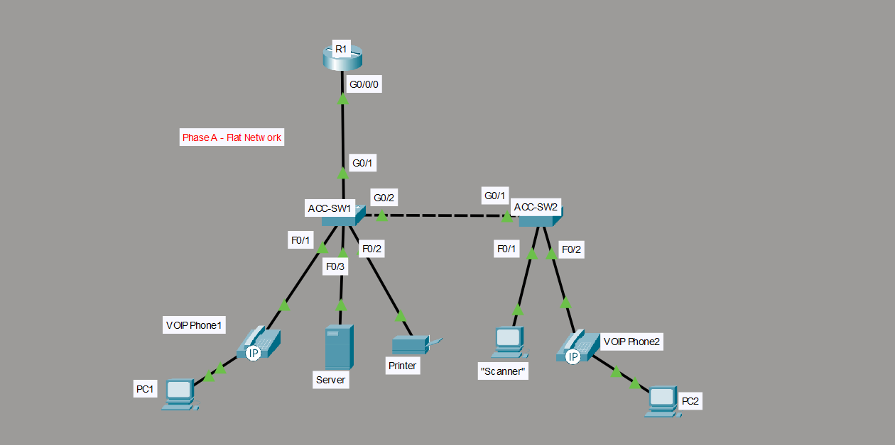
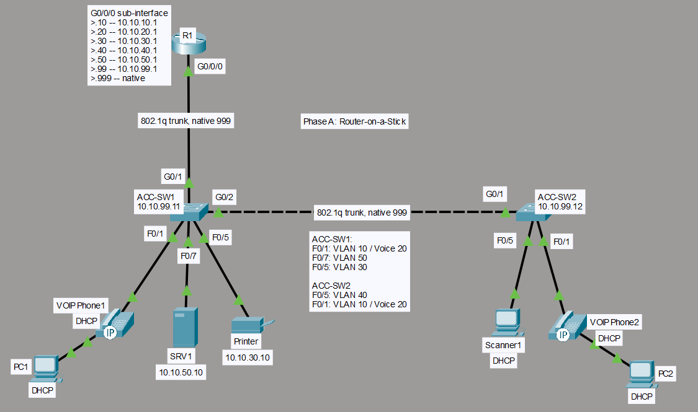
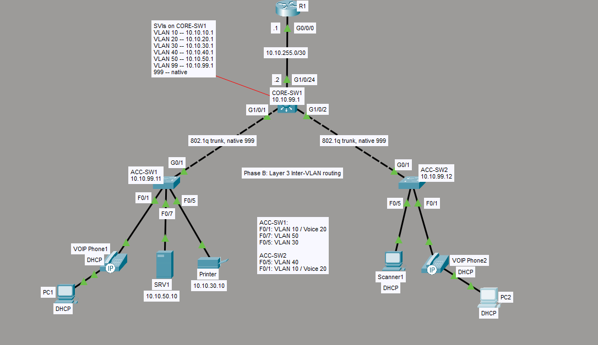
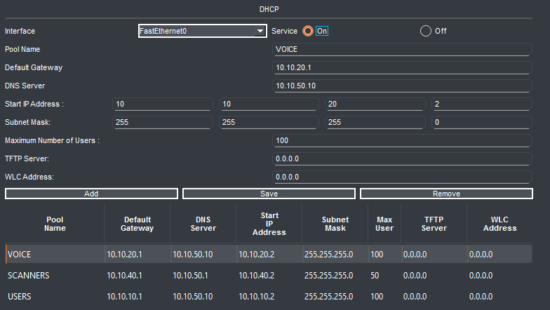
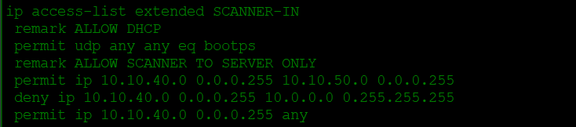
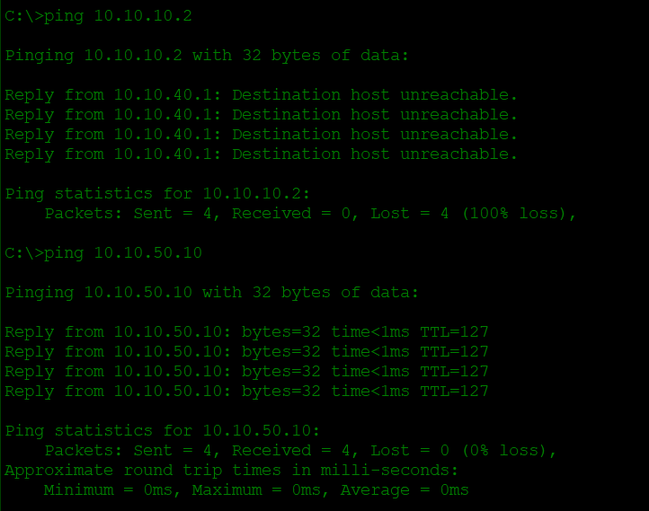
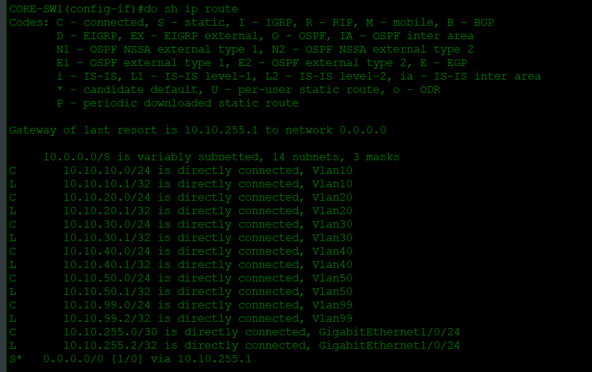
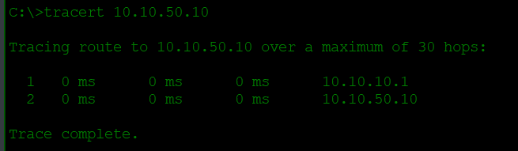

# Project 1 – Branch Site Segmentation

**Topics:** Cisco · VLANs · Native VLAN · Voice VLAN · Port Security · Router-on-a-Stick · Layer 3 Switch SVIs · DHCP Relay · ACLs

**Tool:** Cisco Packet Tracer

## Scenario

A manufacturing branch runs everything on one flat network: office PCs, VoIP phones, printers, warehouse handheld scanners, and servers. A malware infection on one PC reached the scanners and halted shipping for a day. Management wants the network segmented by function, with scanners isolated, centralized DHCP, and a design that can grow.

## Topology

**Phase A – Flat network**



**Phase A – Router-on-a-Stick / segmented**



**Phase B – Layer 3 inter-VLAN routing**



| Device   | Model     | Role                                     |
| -------- | --------- | ---------------------------------------- |
| R1       | ISR4331   | WAN edge (router-on-a-stick in Phase A)  |
| CORE-SW1 | 3650-24PS | Layer 3 core, default gateways (Phase B) |
| ACC-SW1  | 2960-24TT | Office access switch                     |
| ACC-SW2  | 2960-24TT | Warehouse access switch                  |
| SRV1     | Server-PT | Central DHCP server                      |

## Addressing & VLAN Plan

| VLAN | Name     | Subnet        | Gateway    | Notes                                |
| ---- | -------- | ------------- | ---------- | ------------------------------------ |
| 10   | USERS    | 10.10.10.0/24 | 10.10.10.1 | Office PCs (DHCP)                    |
| 20   | VOICE    | 10.10.20.0/24 | 10.10.20.1 | IP phones (DHCP)                     |
| 30   | PRINTERS | 10.10.30.0/24 | 10.10.30.1 | Static                               |
| 40   | SCANNERS | 10.10.40.0/24 | 10.10.40.1 | Warehouse handhelds (DHCP)           |
| 50   | SERVERS  | 10.10.50.0/24 | 10.10.50.1 | Static; DHCP server = 10.10.50.10    |
| 99   | MGMT     | 10.10.99.0/24 | 10.10.99.1 | Static; network infrastructure       |
| 666  | PARKING  | –             | –          | Unused ports, shut down              |
| 999  | NATIVE   | –             | –          | Unused native VLAN on trunks         |

| Device             | Management IP |
| ------------------ | ------------- |
| CORE-SW1 (Phase B) | 10.10.99.1    |
| ACC-SW1            | 10.10.99.11   |
| ACC-SW2            | 10.10.99.12   |

- **Phase B routed link:** R1 G0/0/0 = 10.10.255.1/30, CORE-SW1 G1/0/24 = 10.10.255.2/30
- **Phase B Loopback 0:** R1 L0 = 8.8.8.8/32, simulating an external (Internet) address

## Port Plan

### ACC-SW1

| Ports    | Use                             | VLAN                |
| -------- | ------------------------------- | ------------------- |
| Fa0/1–4  | PCs + phones                    | Access 10, voice 20 |
| Fa0/5–6  | Printers                        | 30                  |
| Fa0/7–8  | Servers                         | 50                  |
| Fa0/9–24 | Unused                          | 666, shutdown       |
| G0/1     | Uplink to R1 (A) / CORE-SW1 (B) | Trunk               |
| G0/2     | Link to ACC-SW2 (Phase A only)  | Trunk               |

### ACC-SW2

| Ports     | Use                                  | VLAN                |
| --------- | ------------------------------------ | ------------------- |
| Fa0/1–4   | PCs + phones                         | Access 10, voice 20 |
| Fa0/5–10  | Scanners (PCs labeled "Scanner")     | 40                  |
| Fa0/11–24 | Unused                               | 666, shutdown       |
| G0/1      | Uplink to ACC-SW1 (A) / CORE-SW1 (B) | Trunk               |

## Design Decisions

- **Baseline configs per device:** Every device starts from the same hardened template (hostname, banner, SSH only, etc.). When something breaks, I can rule out basic misconfiguration and roll back to a known-good state.
- **Separated devices by function:** A VLAN per device function segments the broadcast domains, which helps keep a compromise in one broadcast domain from reaching another at Layer 2.
- **Shut down and "park" unused ports:** Shutting them down and placing them in an unused VLAN means nobody can plug into a random port and reach the switch or another VLAN, which reduces the attack surface.
- **Unused native VLAN:** Keeps untagged traffic away from user traffic and helps prevent VLAN hopping and double tagging.
- **Central DHCP server:** DHCP leases and scopes are managed in one place instead of being configured per VLAN in Cisco IOS.
- **ACL to further isolate scanners:** VLANs break up broadcast domains, but scanners could still reach other devices through the router. An ACL limits what traffic is forwarded across VLANs. The business requirement is that scanners only need to communicate with servers.
- **Migrated inter-VLAN routing to the core switch:** Removes the bottleneck from ACC-SW1 to R1 and lets R1 act as the WAN edge only, which makes future expansion easier to manage.

## Implementation Summary

1. Created and named VLANs on all switches
2. Placed each port in the correct VLAN based on device type
3. Configured access ports with PortFast, voice VLAN, and port security where needed
4. Placed all unused ports in the PARKING VLAN and shut them down
5. Configured trunks with native VLAN 999, pruned allowed lists, and DTP disabled
6. Configured router-on-a-stick on R1 and used `ip helper-address` for DHCP relay on each VLAN
7. Configured SRV1 with DHCP pools for USERS, VOICE, and SCANNERS
8. Configured an ACL to restrict scanners to servers only
9. Returned ACC-SW1 G0/2 to default and placed it in VLAN 666 in shutdown status
10. Configured VLANs on CORE-SW1 and trunks to the access layer with VLANs pruned, DTP disabled, and native VLAN 999
11. Configured a routed link to R1 on CORE-SW1 with next hop 10.10.255.1 (R1)
12. Removed all sub-interfaces from R1
13. Configured a return route on R1 back to the LAN

Full configs: [configs/](Configs/)

## Verification

### VLANs and Port Assignments

**ACC-SW1**

```text
ACC-SW1# show vlan brief

VLAN Name                             Status    Ports
---- -------------------------------- --------- -------------------------------
1    default                          active    Gig0/1, Gig0/2
10   USERS                            active    Fa0/1, Fa0/2, Fa0/3, Fa0/4
20   VOICE                            active    Fa0/1, Fa0/2, Fa0/3, Fa0/4
30   PRINTERS                         active    Fa0/5, Fa0/6
40   SCANNERS                         active
50   SERVERS                          active    Fa0/7, Fa0/8
99   MGMT                             active
666  PARKING                          active    Fa0/9, Fa0/10, Fa0/11, Fa0/12
                                                Fa0/13, Fa0/14, Fa0/15, Fa0/16
                                                Fa0/17, Fa0/18, Fa0/19, Fa0/20
                                                Fa0/21, Fa0/22, Fa0/23, Fa0/24
999  NATIVE                           active
```

**ACC-SW2**

```text
ACC-SW2# show vlan brief

VLAN Name                             Status    Ports
---- -------------------------------- --------- -------------------------------
1    default                          active    Gig0/1, Gig0/2
10   USERS                            active    Fa0/1, Fa0/2, Fa0/3, Fa0/4
20   VOICE                            active    Fa0/1, Fa0/2, Fa0/3, Fa0/4
30   PRINTERS                         active
40   SCANNERS                         active    Fa0/5, Fa0/6, Fa0/7, Fa0/8
                                                Fa0/9, Fa0/10
50   SERVERS                          active
99   MGMT                             active
666  PARKING                          active    Fa0/11, Fa0/12, Fa0/13, Fa0/14
                                                Fa0/15, Fa0/16, Fa0/17, Fa0/18
                                                Fa0/19, Fa0/20, Fa0/21, Fa0/22
                                                Fa0/23, Fa0/24
999  NATIVE                           active
```

### Trunk Ports and Allowed VLANs

**ACC-SW1**

> **Note:** The G0/1 trunk does not show up until the sub-interfaces on R1 are up.

```text
ACC-SW1# show interfaces trunk

Port      Mode       Encapsulation    Status     Native vlan
Gig0/1    on         802.1q           trunking   999
Gig0/2    on         802.1q           trunking   999

Port      Vlans allowed on trunk
Gig0/1    10,20,30,40,50,99,999
Gig0/2    10,20,30,40,50,99,999

Port      Vlans allowed and active in management domain
Gig0/1    10,20,30,40,50,99,999
Gig0/2    10,20,30,40,50,99,999

Port      Vlans in spanning tree forwarding state and not pruned
Gig0/1    10,20,30,40,50,99,999
Gig0/2    10,20,30,40,50,99,999
```

**ACC-SW2**

```text
ACC-SW2# show interfaces trunk

Port      Mode       Encapsulation    Status       Native vlan
Gig0/1    on         802.1q           trunking     999

Port      Vlans allowed on trunk
Gig0/1    10,20,30,40,50,99,999

Port      Vlans allowed and active in management domain
Gig0/1    10,20,30,40,50,99,999

Port      Vlans in spanning tree forwarding state and not pruned
Gig0/1    10,20,30,40,50,99,999
```

### Router-on-a-Stick Sub-interfaces on R1 (Phase A)

```text
R1# show ip interface brief

Interface                 IP-Address   OK?   Method    Status  Protocol
GigabitEthernet0/0/0      unassigned   YES   unset     up      up
GigabitEthernet0/0/0.10   10.10.10.1   YES   manual    up      up
GigabitEthernet0/0/0.20   10.10.20.1   YES   manual    up      up
GigabitEthernet0/0/0.30   10.10.30.1   YES   manual    up      up
GigabitEthernet0/0/0.40   10.10.40.1   YES   manual    up      up
GigabitEthernet0/0/0.50   10.10.50.1   YES   manual    up      up
GigabitEthernet0/0/0.99   10.10.99.1   YES   manual    up      up
GigabitEthernet0/0/0.999  unassigned   YES   unset     up      up
```

### Central DHCP Server Scopes (SRV1)



### ACL Restricting Scanners to Servers Only (`SCANNER-IN`)



**Scanner can't ping PC1 but can ping SRV1:**



### CORE-SW1 Routes (Phase B)



### CORE-SW1 Acting as Gateway

**PC2 pings SRV1:**



## Troubleshooting Log

| Symptom | Root cause | How I found it | Fix |
| ------- | ---------- | -------------- | --- |
| `%SPANTREE-2-BLOCK_PVID_LOCAL` / `NATIVE_VLAN_MISMATCH`: G0/1 blocked on VLAN 1; native VLAN mismatch with ACC-SW1 G0/2 (999) | ACC-SW2 was still on the default native VLAN 1 | Ran `show interfaces trunk` on both access switches and saw I had missed setting native VLAN 999 on ACC-SW2 | Set the native VLAN to 999 on ACC-SW2 G0/1 |
| DHCP requests failed on all devices | No static IP configured on the DHCP server interface | Double-checked all DHCP configs on R1 (`ip helper-address`) and the scopes, and all were correct. Then noticed I never set SRV1 to 10.10.50.10 | Configured the IP address and gateway on SRV1 |
| Scanner still not getting an IP; DHCP request failed | `ip helper-address` on one sub-interface had a typo | First suspected the ACL was blocking the scanners from reaching DHCP, but while reviewing the running config I noticed sub-interface G0/0/0.40 had the wrong helper address | Corrected the helper address on G0/0/0.40 |
| Created a loopback on R1 to simulate the "Internet" and test routing between R1 and CORE-SW1; pings from PC2 failed | R1 had no return route to the 10.10.0.0/16 LAN | Ran `tracert` from PC2 and confirmed it reached the CORE-SW1 gateway. Pings from CORE-SW1 G1/0/24 succeeded. With no NAT configured, traffic left the core switch sourced from PC2 (10.10.10.3), and R1 had no route back to that subnet | Added a route on R1 to 10.10.0.0/16 so all LAN subnets can be reached |

## Lessons Learned

- **A loopback on R1 wasn't reachable from PC2.** I added a loopback on R1 to simulate an external address and test reachability from PC2, and the pings failed when I expected them to succeed. R1 had no return route back to the LAN. In production, an unverified change like this could cause an outage, which is why building and testing in a lab first is so valuable.
- **Small mistakes take down connectivity.** Verifying with `show` commands after each task felt redundant, but it would have saved me from tracing back through steps to find a typo or an incorrect command. Going forward I'll verify after each task to cut down on troubleshooting and backtracking time.

## Skills Demonstrated

VLANs, trunking, port security, Layer 3 switching, DHCP relay, ACLs

---

